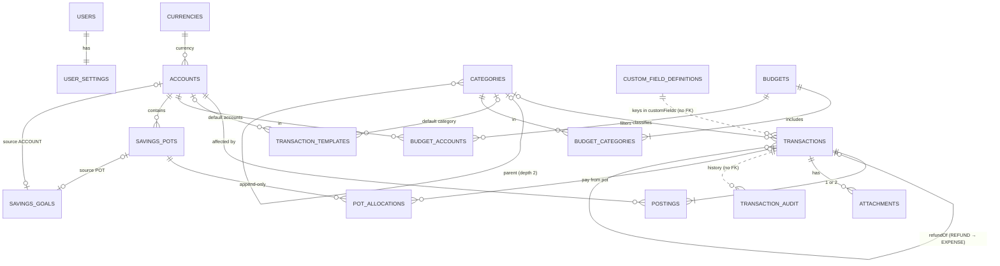
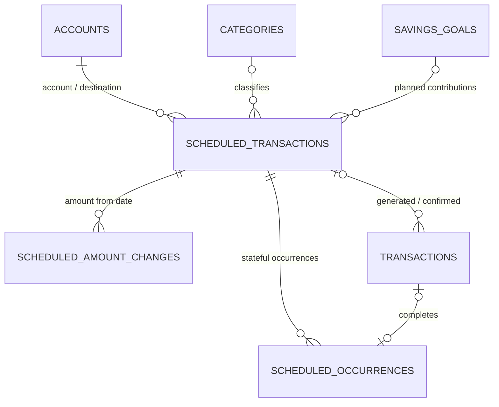
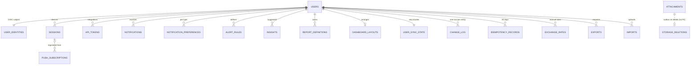

# Entity Relationships

**[Accepted]** ownership and cascade model ([ADR-0006](../decisions/ADR-0006-user-data-isolation.md)). **[Proposed]** individual deletion rules where marked. Columns are in [data-model.md](data-model.md). FK mechanics (composite `(id, user_id)` keys, `NoAction` vs. `Restrict`) are in [database-architecture.md](../architecture/database-architecture.md#2-composite-ownership-foreign-keys).

## 1. Ownership

Every owned table hangs off `users` with `ON DELETE CASCADE`. Between owned tables, references are **composite** (`(child.parent_id, child.user_id) → parent(id, user_id)`), so a cross-user reference cannot be stored. This edge to `users` is omitted from the diagrams below to keep them readable: assume it on every entity except `currencies`, `app_settings`, `storage_deletions`, `backups`, and provider rows of `exchange_rates`.

## 2. Diagrams

### Ledger, budgets, savings

### Scheduling

### Identity, notifications, sync, operations

`alert_rules.config`, `notifications.link`, and `insights.params` reference entities by ID inside JSONB/text. They have no FK and are handled by the rules in §3.

**Implemented so far:** Stage 1 `app_settings`, `currencies`; Stage 2 (migration `20261119000000_identity`) `users`, `user_settings` (PK = `user_id`; `base_currency` → `currencies(code)` `NoAction`, so a referenced currency can never be deleted), `user_identities` (`UNIQUE (issuer, subject)`, one per user and issuer), `sessions`, `api_tokens`, each with `user_id → users ON DELETE CASCADE` and (except `user_settings`) `UNIQUE (id, user_id)` for future composite references.

## 3. Deletion rules

"Blocked" means the database rejects the delete (`NoAction` composite FK) and the service checks first to return a friendly `422` code. "Service" means the application performs the listed steps in the same DB transaction (with audit and change log) before deleting.

| Deleting | Effect on dependants | Enforced by |
|---|---|---|
| **User** (deferred UI, CLI later) | Cascade through every owned table. Storage objects enqueued in `storage_deletions`. | `ON DELETE CASCADE` from `users` + service for storage |
| **Account** | Allowed only with no postings, pots, schedules, goals, or budget/template links that the user has not cleared ([features.md](../product/features.md#accounts)). Otherwise archive. Budget account filters and template defaults referencing it are removed by the service on delete. | Blocked (postings, pots, schedules, goals) + service |
| **Category** | Transactions reassigned or uncategorized (each with an audit `UPDATE`). Subcategories follow the same choice. Removed from `budget_categories`. Templates and schedules lose the reference (warning). Category-spending alert rules are disabled (`REFERENCE_DELETED`). Subcategories of a deleted parent are deleted with it (composite self-FK `ON DELETE CASCADE`; the UI names how many). | Service, then delete; FKs `NoAction` catch misses; cascade for subcategories |
| **Transaction** | Postings deleted. Attachments deleted and objects enqueued in `storage_deletions`. Minimal audit `DELETE` written (no financial data); earlier `CREATE`/`UPDATE` audit rows kept for the lifetime of the user (OQ-11). Deleting a refund leaves its expense unchanged. An expense with refunds: blocked until the user deletes its refunds (`422 EXPENSE_HAS_REFUNDS`, composite FK `refundOfId` `NoAction`; refunds are never deleted implicitly; [OQ-24](../planning/open-questions.md#oq-24-deleting-an-expense-that-has-refunds)). Linked occurrence: `transactionId` cleared, `transactionDeletedAt` set, user asked skip/keep due. A linked fee expense: the user chooses delete or keep (kept fee gets `transferFeeOfId = null`). `pot_allocations.transactionId` set to null (the allocation stays; it is history). | Service; FK for refunds |
| **Transaction template** | Nothing references it by FK (`transactions.templateId` is provenance only). | n/a |
| **Custom field definition** | Blocked while any transaction has a value for it; archive instead. | Service |
| **Scheduled transaction** | Amount changes and occurrence records deleted. Generated transactions are **kept**; their `scheduledTransactionId`/`occurrenceDate` are cleared (they are actual history). | Service |
| **Budget** | `budget_categories`, `budget_accounts` deleted. Its `BUDGET_THRESHOLD` alert rules deleted with it. | Service + cascade on join rows |
| **Savings pot** | Not deletable; archive at balance 0. Deleting is possible only for a pot with no allocations (created by mistake). A goal sourced from it must be archived or re-pointed first. | Blocked + service |
| **Pot allocation** | Never deleted (append-only); correct with a reverse allocation. | Service (no delete command) |
| **Savings goal** | Schedules lose `savingsGoalId`. | Service |
| **Session** (revoke/purge) | Push subscriptions registered from it deleted by the revoke service; FK `SET NULL` covers the purge path. | Service + `SET NULL` |
| **API token** (revoke/purge) | Revocation only sets `revokedAt`; the purge deletes the row. Audit rows keep `apiTokenId` (no FK) and the copied name. | Service |
| **Attachment** | Row deleted, `storage_deletions` row inserted in the same transaction, quota released, audit `attachments.removed`. | Service |
| **Alert rule, report definition, notification, insight, template** | Leaf entities, no dependants. | n/a |
| **Exchange rate** | No dependants (postings hold snapshots, INV-6). Manual rates have no delete endpoint (saving the same pair and date replaces them); a user's manual rates go with the user. | n/a |
| **Currency** | Never deleted (reference data); deactivated instead. | Migration policy |

## 4. Archive instead of delete

| Entity | Archive effect |
|---|---|
| Account | No new postings, allocations, or schedules. Balance still counts in net worth. Requires pots released or archived. |
| Category | Hidden from the default list and entry pickers. An archived parent hides its subcategories, which keep their own `archivedAt`; no new subcategory under an archived parent. |
| Savings pot | Balance must be 0. Hidden from pickers. |
| Savings goal | Status `ARCHIVED`; frees the one-active-goal slot for its source. |
| Custom field definition | Hidden from forms; values kept and shown read-only. |

## 5. Invariants that span relationships

Checked by services and, where noted, by the database (see [financial-domain-model.md](../architecture/financial-domain-model.md#core-invariants)):

- Same owner for every reference (composite FKs, INV-1).
- Posting count and signs per transaction type (service + optional deferred trigger, INV-4).
- `postings.accountCurrency = accounts.currency` (service, INV-5).
- Category depth ≤ 2 and child type = parent type (trigger).
- At most one transaction per `(scheduledTransactionId, occurrenceDate)` (partial unique index, INV-9).
- At most one ACTIVE/PAUSED goal per pot or account (partial unique index).
- `savings_goals.targetCurrency` = source currency (service).
- Pot balance never negative (pot row lock + service).
