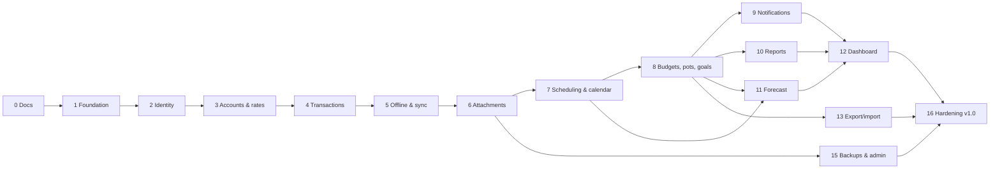

# Roadmap

Overview of the implementation stages. Stage contents, prerequisites, and acceptance criteria are canonical in [implementation-stages.md](implementation-stages.md).

## Stages

**Progress:** Stage 1 (Foundation) is completed and accepted by the user (2026-11-18). Stage 2 has not started. Per-stage status is recorded in [implementation-stages.md](implementation-stages.md#stage-1-foundation).

| # | Stage | Main outcome |
|---|---|---|
| 0 | Discovery, architecture and documentation | This documentation |
| 1 | Foundation | Deployable skeleton, local validation, theme, i18n, PWA shell |
| 2 | Identity and users | Auth, sessions, personal API tokens, settings, admin users, isolation harness |
| 3 | Currencies, rates, accounts and categories | Reference data and balances |
| 4 | Transactions | Ledger, quick/full entry, history, search |
| 5 | Offline and synchronization | Offline-first with safe multi-device sync |
| 6 | Attachments and storage | Files, quotas, local and S3 drivers |
| 7 | Scheduling, jobs and calendar | Recurring/planned transactions, reminders, calendar |
| 8 | Budgets, savings pots and goals | Spending control and savings |
| 9 | Notifications, push, alerts and insights | Notification center, Web Push, alert rules, suggestions |
| 10 | Reports | Aggregated analytics and export |
| 11 | Forecasting | Projected balances |
| 12 | Configurable dashboard | Per-user widget layout |
| 13 | User export and import | Data portability |
| 14 | *(removed)* | OIDC moved into Stage 2 ([ADR-0020](../decisions/ADR-0020-oidc-only-authentication.md)) |
| 15 | Backups, restore and admin operations | Consistent backups, restore, admin completion |
| 16 | Hardening and v1.0 | Security, accessibility, performance, release |

## Dependency graph

## Rationale for the order

- **Isolation and the command pipeline come early** (Stages 2 and 4) because every later feature depends on them and retrofitting is risky.
- **Offline sync right after transactions** (Stage 5): the sync protocol constrains every synced entity, so later entities are built sync-ready from the start instead of being migrated.
- **Scheduling before budgets and forecast**: budgets and forecasts consume occurrences.
- **OIDC is part of Stage 2**: it is the only authentication method ([ADR-0020](../decisions/ADR-0020-oidc-only-authentication.md)), so Stage 14 was removed and its number left unused.
- **Backups after attachments**: the consistency model depends on the storage deletion outbox from Stage 6. Operators running early builds should use `pg_dump` and volume copies until Stage 15.

## Milestones

| Milestone | After stage | Usable for |
|---|---|---|
| Internal alpha | 5 | Daily expense tracking by the owner, online and offline |
| Beta | 11 | Household use with budgets, recurring payments, reports, forecast |
| v1.0 | 16 | General self-hosted use |
